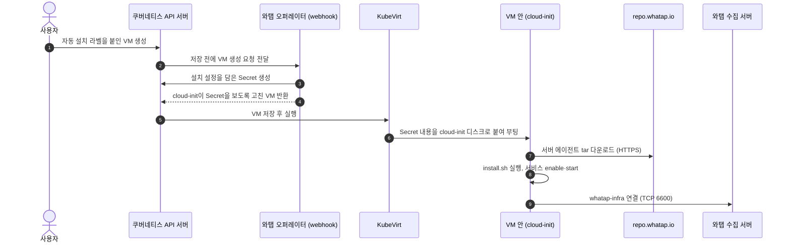

# KubeVirt VM 서버 에이전트 자동 설치: 작동 방식

> 설정 항목 상세는 `examples/kubevirt-server-agent.md`를 참고한다. 고객용 설명은 docs.whatap.io의 Kubernetes 소개 문서(`kubernetes/introduction`)에 있다.

## 한 줄 요약

자동 설치 라벨을 붙여 **새 KubeVirt VM을 만들면**, 와탭 오퍼레이터가 VM의 cloud-init 설정에 설치 스크립트를 끼워 넣는다. VM이 **처음 부팅될 때** 그 스크립트가 공식 tar로 서버 에이전트(`whatap-infra`)를 설치하고 서비스를 시작한다.

## 왜 필요한가

KubeVirt VM은 쿠버네티스 위에서 실행되지만, 안쪽은 독립된 Linux 서버다. 컨테이너처럼 사이드카나 initContainer로 에이전트를 넣을 수 없다. 그래서 지금까지는 VM마다 접속해서 서버 에이전트를 직접 설치해야 했다.

이 기능을 쓰면 VM을 만드는 것만으로 서버 에이전트 설치와 실행까지 끝난다.

## 전체 흐름



1. 사용자가 자동 설치 라벨을 붙인 VM을 만든다.
2. 쿠버네티스 API 서버는 VM을 저장하기 전에 와탭 오퍼레이터의 webhook에 요청을 보낸다.
3. 오퍼레이터는 WhatapAgent CR의 대상 설정과 VM을 비교한다. 대상이면 설치 스크립트와 연결 설정을 cloud-init에 합치고, 결과를 Secret으로 만든 뒤 VM이 그 Secret을 쓰도록 고쳐서 돌려준다.
4. KubeVirt가 VM을 실행하면서 Secret 내용을 cloud-init용 디스크로 VM에 붙인다.
5. VM이 처음 부팅되면 cloud-init이 설치 스크립트를 실행한다. 스크립트는 tar를 내려받아 공식 `install.sh`로 설치하고 서비스를 시작한다.
6. 서버 에이전트가 수집 서버에 연결되면 서버 프로젝트의 서버 목록에 VM이 나타난다.

## 구성 요소와 역할

| 구성 요소 | 위치 | 역할 |
| --- | --- | --- |
| WhatapAgent CR `spec.features.kubeVirt` | 클러스터 | 어떤 VM에, 어떤 서버 프로젝트와 버전으로 설치할지 정하는 정책 |
| 오퍼레이터 컨트롤러 | 오퍼레이터 Pod | `enabled: true`이면 `whatap-webhook`에 KubeVirt용 webhook 항목을 등록하고, `false`면 제거 |
| KubeVirt admission webhook | 오퍼레이터 Pod | VM 생성 요청을 받아 cloud-init 병합, Secret 생성, VM 수정 |
| cloud-init Secret (`whatap-kv-<해시>`) | VM 네임스페이스 | 병합된 cloud-init 전체(액세스 키 포함). 변경 불가(immutable), WhatapAgent CR 소유. VM이 사라지면 오퍼레이터가 지운다. |
| cloud-init | VM 안 | 첫 부팅 때 Secret에 적힌 파일 작성과 명령 실행을 한 번 수행 |
| 설치 스크립트 | VM 안 `/usr/local/sbin/whatap-kubevirt-install.sh` | tar 다운로드, 검사, 설치, 서비스 시작 |
| 공식 installer `install.sh` | tar 안 | 파일 복사, 서비스 파일 생성과 등록. 서비스 시작은 하지 않음 |
| `whatap-infra` 서비스 | VM 안 | 서버 에이전트 본체. 수집 서버와 통신 |

## 단계별 상세

### 1. 정책 설정

```yaml
apiVersion: monitoring.whatap.com/v2alpha1
kind: WhatapAgent
metadata:
  name: whatap
spec:
  features:
    kubeVirt:
      enabled: true
      targets:
        - name: linux-vm
          enabled: true
          namespace: vms              # 정확히 이 네임스페이스만
          vmSelector:                 # VM의 metadata.labels와 비교
            matchLabels:
              app: my-vm
          agentVersion: "2.9.25"      # 생략하면 오퍼레이터 기본 버전, latest는 쓰지 않음
          license: "<서버 프로젝트 액세스 키>"   # 또는 licenseSecretRef (둘 중 하나)
          host: "<수집 서버 IP>"       # 여러 개면 '/'로 구분
          port: 6600
```

- 대상이 되려면 세 가지가 모두 맞아야 한다: VM 라벨 `monitoring.whatap.com/server-agent: "true"`, `namespace` 정확히 일치, `vmSelector` 일치.
- `vmSelector`는 VM 자체의 라벨을 본다. VM 안에서 실행되는 Pod(virt-launcher)의 라벨은 보지 않는다.
- 액세스 키는 서버 프로젝트의 키여야 한다. 쿠버네티스·APM 프로젝트 키를 자동으로 가져다 쓰지 않는다.
- `agentVersion`은 `X.Y.Z` 숫자 형식만 받는다(최대 32자). 잘못된 값이 다운로드 주소나 명령에 섞이지 않게 하기 위해서다. 해당 버전이 실제로 게시돼 있는지는 확인하지 않는다.
- `agentVersion`을 생략하면 VM을 만들 때 오퍼레이터 기본 버전을 쓴다(3.0.25 기준 2.9.25). 오퍼레이터를 올리면 생략한 대상은 새 기본 버전을 따른다.
  - 3.0.24 CRD는 생략한 값을 `2.9.25`로 CR에 저장한다. 그 CRD로 만든 CR은 이 값이 고정돼 있으니, 기본 버전을 따르려면 CR에서 `agentVersion`을 지운다.

### 2. VM 생성 때 webhook의 판단

| 상황 | 결과 |
| --- | --- |
| 자동 설치 라벨 없음 | webhook이 호출되지 않는다. 그대로 생성되고 설치하지 않는다. |
| `kubeVirt.enabled: false` | webhook 등록이 없다. 그대로 생성되고 설치하지 않는다. |
| 라벨은 있지만 일치하는 대상 없음 | 그대로 생성되고 설치하지 않는다. |
| 일치하는 대상이 2개 이상 | 생성을 거부한다. 임의로 하나를 고르지 않는다. |
| CR 설정 오류 | 생성을 거부한다. |
| 사용자 데이터가 지원하지 않는 형식(셸 스크립트, MIME 등)이거나 예약 경로와 충돌 | 생성을 거부한다. |
| `licenseSecretRef`의 Secret이나 키가 없음 | 생성을 거부한다. |
| 오퍼레이터가 10초 안에 응답하지 않음 | 생성을 거부한다(`failurePolicy: Fail`). |
| 위에 해당하지 않음 | cloud-init 병합, Secret 생성, VM 수정 후 생성된다. |

라벨이 없는 일반 VM은 webhook을 거치지 않으므로 오퍼레이터 상태와 관계없이 영향이 없다.

### 3. webhook이 VM에 넣는 것

- **cloud-init 병합**: 사용자가 쓴 `#cloud-config` 내용은 그대로 두고 아래만 덧붙인다.
  - `write_files` 2개: 설치 스크립트(0700), 연결 설정 `/etc/whatap-kubevirt/whatap.conf`(0600, 액세스 키·host·port)
  - `runcmd` 1줄: `/bin/bash /usr/local/sbin/whatap-kubevirt-install.sh`
- **Secret 저장**: 병합 결과를 VM 네임스페이스에 Secret으로 저장한다. 이유는 두 가지다. 액세스 키가 VM 명세에 보이지 않게 하고, KubeVirt의 inline userData 크기 제한(2048 bytes)을 피하기 위해서다.
  - 이름은 정책 UID, VM, 내용으로 정해진다. 같은 요청을 다시 보내면 같은 Secret을 재사용한다.
  - 같은 이름의 다른 Secret이 있으면 덮어쓰지 않고 생성을 거부한다.
- **VM 수정**: cloud-init 볼륨의 `userData`를 지우고 `secretRef.name`으로 바꾼다. annotation 2개를 남긴다.
  - `monitoring.whatap.com/server-agent-bootstrap`: Secret 이름. **설치 완료 표시가 아니다.**
  - `monitoring.whatap.com/server-agent-target`: 적용된 대상 이름
- dry-run 요청에는 Secret을 만들지 않는다.
- 이미 있는 Secret을 재사용하면 Secret의 `monitoring.whatap.com/bootstrap-admitted-at` annotation을 갱신한다. 아래 Secret 정리가 이 Secret을 지우지 않게 하기 위해서다.

### Secret 정리

Secret은 VM보다 먼저 만들어지므로 VM을 소유자로 둘 수 없다. 그래서 쿠버네티스 GC 대신 오퍼레이터가 5분마다 직접 정리한다.

- **지우는 대상**: Secret의 `monitoring.whatap.com/bootstrap-vm`에 적힌 VM이 이 Secret을 더는 쓰지 않는 경우다. VM의 `server-agent-bootstrap` annotation과 볼륨 어디에도 이 Secret이 없어야 한다. VM이 지워졌거나, 같은 이름의 VM이 다른 Secret을 쓰는 경우가 여기에 해당한다. VM이 없어도 같은 이름의 VMI가 남아 있으면 지우지 않는다.
- **지우는 조건**: 만든 지 10분이 지났고, 연속된 두 번의 점검에서 같은 resourceVersion으로 쓰이지 않는 것으로 확인돼야 한다. 삭제 요청에는 그 UID와 resourceVersion을 전제조건으로 건다. 그래서 VM을 지우고 5~10분 뒤에 지워진다. webhook 뒤에 VM 생성이 실패해 남은 Secret은 만들어지고 15~20분 뒤에 지워진다.
- **건드리지 않는 대상**: 이름이 `whatap-kv-`로 시작하지 않거나, 오퍼레이터 라벨이나 `bootstrap-vm` annotation이 없거나, WhatapAgent가 아닌 다른 controller가 소유한 Secret. VM 목록을 읽지 못한 네임스페이스도 건드리지 않는다.
- Secret은 메타데이터만 읽는다. 액세스 키가 든 Secret 내용은 읽지 않는다. VM은 볼륨 참조를 보려고 명세까지 읽는다. 리더 오퍼레이터 한 대에서만 돌며, 지운 Secret마다 `deleted unused KubeVirt bootstrap Secret` 로그를 남긴다.
- 필요한 권한: Secret `list`·`delete`·`patch`, `kubevirt.io` `virtualmachines`·`virtualmachineinstances` `list`.

### 4. 첫 부팅 때 설치 스크립트가 하는 일

1. root인지 확인하고, 이전 실행의 성공 기록을 먼저 지운다.
2. OS(`/etc/os-release` ID)와 아키텍처를 확인한다. x86_64는 amd64, aarch64·arm64는 arm64 tar를 고른다.
3. `systemctl`, `curl`, `tar`가 있는지 확인한다.
4. 에이전트 설정 파일(`/usr/whatap/infra/conf/whatap.conf`)을 root 전용(0600)으로 미리 만든다. 이미 다른 에이전트가 설치돼 있으면 덮어쓰지 않고 중단한다.
5. `https://repo.whatap.io/infra/whatap-infra-<버전>-linux-<arch>.tar.gz`를 내려받는다(HTTPS만, 재시도 2회, 최대 120초).
6. 압축을 풀기 전에 내용을 검사한다. 상위 경로로 빠져나가는 항목, 링크, 특수 파일, 중복 항목이 있으면 중단한다. tar 안의 버전이 요청한 버전과 같은지도 확인한다.
7. 공식 `install.sh --prefix /usr/whatap/infra`를 실행한다. 미리 만든 설정 파일은 installer가 그대로 보존한다.
8. 설치된 버전과 설정 파일이 기대한 대로인지 다시 확인한다.
9. `systemctl daemon-reload` → `enable` → `start` → `is-active` 순서로 서비스를 시작하고 확인한다.
10. 성공 기록(`/var/lib/whatap-kubevirt/success`)을 남기고 임시 다운로드 폴더를 지운다.

중간에 하나라도 실패하면 성공 기록을 남기지 않는다. VM 부팅 자체는 계속되고, cloud-init 상태가 `error`가 된다.

### 5. 데이터 수집

`whatap-infra` 서비스(watchdog과 에이전트 프로세스 2개)가 수집 서버(기본 TCP 6600)에 연결한다. 서버 프로젝트의 서버 목록에는 VM의 호스트 이름으로 나타난다.

## 설계 결정과 이유

- **cloud-init을 쓰는 이유**: initContainer는 Pod 안에서 앱 컨테이너보다 먼저 실행되는 별도 컨테이너라 VM 안의 OS를 바꿀 수 없다. cloud-init은 VM OS 안에서 첫 부팅 때 실행되는 초기화 도구라 VM 안에 설치할 수 있다. KubeVirt가 공식 지원하는 방식이기도 하다.
- **새 VM만 지원하는 이유**: cloud-init은 첫 부팅 때 한 번만 실행된다. 이미 실행 중인 VM에 설치하려면 SSH나 게스트 에이전트로 접속해야 하므로 범위에서 뺐다. webhook도 생성(CREATE) 요청만 처리하고 기존 VM은 건드리지 않는다.
- **tar 방식인 이유**: Debian 계열과 RPM 계열 모두 같은 공식 tar와 `install.sh`로 설치할 수 있다. apt/yum 저장소를 추가하거나 배포판마다 다른 경로를 둘 필요가 없다.
- **버전을 고정하는 이유**: 같은 정책이면 언제 만든 VM이든 같은 버전이 설치되게 하려고 latest를 따라가지 않는다. 기본 버전은 오퍼레이터에 들어 있다(3.0.25 기준 2.9.25). CRD에는 기본값을 두지 않는다. CRD 기본값은 CR에 저장돼서 오퍼레이터를 올려도 바뀌지 않기 때문이다.
- **서비스 시작을 직접 하는 이유**: 공식 `install.sh`는 서비스 등록까지만 하고 시작하지 않는다.
- **매번 설치하는 이유**: tar 설치는 dpkg/rpm에 기록되지 않는다. 그래서 패키지 DB로 설치 여부를 판단하지 않고, 스크립트를 실행할 때마다 tar를 받아 설치한다.
- **라벨 opt-in과 실패 시 거부**: 라벨을 붙인 VM만 대상이다. 오퍼레이터 장애 때 에이전트 없이 조용히 부팅되는 것보다 생성이 실패해서 바로 알 수 있는 쪽을 택했다. 라벨 없는 VM에는 영향이 없다.
- **파일 권한**: 설치 스크립트는 umask 077로 비밀이 든 파일을 root 전용으로 만든다. 공식 installer만 umask 022로 실행해서 서비스 파일이 표준 권한(644)으로 만들어지게 한다. 0600 서비스 파일은 systemd가 설정을 다시 읽을 때마다 경고를 남기기 때문이다.

## VM 안에 생기는 파일

| 경로 | 권한 | 내용 |
| --- | --- | --- |
| `/usr/local/sbin/whatap-kubevirt-install.sh` | 0700 | 설치 스크립트 |
| `/etc/whatap-kubevirt/whatap.conf` | 0600 | 오퍼레이터가 넣은 연결 설정(액세스 키, host, port) |
| `/var/lib/whatap-kubevirt/` | 0700 | 상태 폴더(`input.conf`, `managed.conf`, `success`) |
| `/usr/whatap/infra/whatap_infrad` | 0755 | 서버 에이전트 실행 파일 |
| `/usr/whatap/infra/conf/whatap.conf` | 0600 | 에이전트 설정(액세스 키 포함) |
| `/usr/whatap/infra/conf/VERSION` | 0644 | 설치된 버전 |
| `/etc/whatap/infra.meta` | 0644 | 공식 installer가 남기는 설치 정보(버전, 아키텍처, init 방식) |
| `/etc/systemd/system/whatap-infra.service` | 0644 | 서버 에이전트 서비스 파일 |
| `/etc/systemd/system/whatap-updater.service` | 0644 | 업데이트용 서비스 파일. 설치만 되고 활성화되지 않음 |

## 확인 방법

각 단계는 서로 다른 사실이다. 앞 단계가 성공했다고 다음 단계까지 성공한 것은 아니다.

1. **설정 주입**: VM에 Secret 참조가 들어갔는지 확인한다. 설치 완료를 뜻하지 않는다.

   ```bash
   kubectl get vm <VM 이름> -n <네임스페이스> \
     -o jsonpath='{.metadata.annotations.monitoring\.whatap\.com/server-agent-bootstrap}'
   ```

2. **cloud-init 완료**: VM 안에서 `cloud-init status --wait` 결과가 `status: done`인지 확인한다.
3. **서비스 실행**: VM 안에서 확인한다.

   ```bash
   systemctl status whatap-infra          # active (running)
   cat /etc/whatap/infra.meta             # INSTALL_VERSION, INSTALL_ARCH
   cat /usr/whatap/infra/conf/VERSION
   ```

4. **데이터 수신**: 서버 프로젝트의 서버 목록에서 VM 호스트 이름과 지표를 확인한다.

## 실패할 때

| 증상 | 가능한 원인 | 확인할 것 |
| --- | --- | --- |
| VM 생성이 거부됨 | 대상 2개 이상 일치, 사용자 데이터 형식, Secret 없음, 오퍼레이터 미준비 | 거부 메시지, 오퍼레이터 Pod 상태 |
| VM은 생성됐지만 annotation이 없음 | 라벨 누락, 대상 불일치, `enabled: false` | VM 라벨, CR 대상 설정 |
| `cloud-init status`가 `error` | OS·아키텍처 미지원, 필수 도구 없음, 다운로드 실패, 기존 에이전트 존재 | `/var/log/cloud-init-output.log`에서 `WhaTap`으로 시작하는 메시지 |
| 서비스는 active인데 서버 목록에 없음 | 서버 프로젝트 키가 아님, 수집 서버 주소 오류, 6600 포트 차단 | `ss -tn`으로 수집 서버 연결 확인 |

설치 스크립트가 남기는 메시지:

- `WhaTap bootstrap refused an unsupported or conflicting guest state.`: 지원하지 않는 OS이거나 기존 에이전트·설정과 충돌
- `WhaTap bootstrap requires an amd64 or arm64 guest.`: 지원하지 않는 아키텍처
- `WhaTap bootstrap requires systemctl, curl, tar and trusted CA certificates.`: 필수 도구 없음
- `WhaTap archive download failed; check HTTPS connectivity and trusted CA certificates.`: tar 다운로드 실패
- `WhaTap bootstrap failed; inspect installer/service state locally.`: 설치나 서비스 시작 단계 실패

## 제한 사항

- 이미 생성됐거나 실행 중인 VM에는 설치하지 않는다.
- 정책을 바꿔도 이미 설치된 VM에는 반영되지 않는다. 이후 생성하는 VM부터 적용된다.
- 에이전트 업데이트·삭제 기능은 없다. 공개 문서의 apt/yum 업데이트·삭제 방법은 tar 설치에 해당하지 않는다.
- Windows와 Fedora는 지원하지 않는다.
- 사용자 데이터는 비어 있거나 `#cloud-config` 형식이어야 한다.
- 다운로드는 HTTPS와 압축 구조·버전 검사로 확인하며, 패키지 서명 검증은 아니다.
- `success` 파일은 설치와 서비스 시작이 성공했다는 기록일 뿐 데이터 수신 성공을 뜻하지 않는다.
- cloud-init Secret은 VM을 지우고 5~10분 뒤에 오퍼레이터가 지운다(3.0.25부터, 이전 버전에서 남은 Secret 포함). 그래서 오퍼레이터가 고친 VM 명세(`server-agent-bootstrap` annotation 포함)를 저장해 두었다가 나중에 다시 만들면 거부된다. 원래 매니페스트로 만든다.
- WhatapAgent CR을 지우면 Secret도 함께 지워지므로, 그 Secret을 쓰는 VM은 다시 시작할 때 영향을 받을 수 있다.

## 검증 결과

| 항목 | 결과 |
| --- | --- |
| 환경 | 내부 테스트 클러스터(Kubernetes 1.30.4, KubeVirt 1.8.4) |
| 게스트 | Ubuntu 24.04.5 LTS amd64, 새 디스크 |
| 설치 | 공식 tar 2.9.25. VM 생성 후 약 4~5분 뒤 서비스 실행(대부분 디스크 이미지 다운로드 시간) |
| 서비스 | enabled·active, 재시작 0회, 서비스 파일 0644, systemd 권한 경고 0건 |
| 수집 | 수집 서버 TCP 연결, 서버 프로젝트 데이터 수신 확인 |
| 자동 테스트 | Linux 전체 Go 테스트 104개 통과. 설치 스크립트 테스트는 가짜 installer를 쓰는 격리 환경이다. |
| 미검증 | Debian·RHEL 계열·Amazon Linux 실제 VM, arm64, 2.9.25 외 버전, ConfigDrive 실제 VM |

## 관련 코드

- `api/v2alpha1/kubevirt_types.go`: CR 필드
- `internal/kubevirt/policy.go`: 정책 검증과 대상 선택
- `internal/controller/kubevirt_webhook.go`: webhook 등록
- `internal/webhook/v2alpha1/kubevirt_webhook.go`: VM 생성 요청 처리(병합, Secret, VM 수정)
- `internal/webhook/v2alpha1/kubevirt_bootstrap_gc.go`: 쓰이지 않는 cloud-init Secret 정리
- `internal/kubevirt/cloudinit/render.go`, `validate.go`: cloud-init 병합과 검증
- `internal/kubevirt/cloudinit/bootstrap.sh`: VM 안에서 실행되는 설치 스크립트
- `config/crd/bases/monitoring.whatap.com_whatapagents.yaml`: CRD
- `examples/kubevirt-server-agent.yaml`, `examples/kubevirt-server-agent.md`: 설정 예제와 상세 규칙
